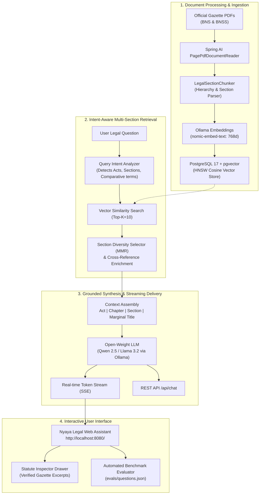

# Nyaya — Legal Research RAG Chatbot

[](https://openjdk.org/projects/jdk/21/)
[](https://spring.io/projects/spring-boot)
[](https://spring.io/projects/spring-ai)
[](https://github.com/pgvector/pgvector)
[](https://ollama.com/)
[](evals/EVAL_REPORT.md)

**Nyaya** is a production-grade, high-performance Retrieval-Augmented Generation (RAG) system engineered for statutory research over India's new criminal codes:
* **Bharatiya Nyaya Sanhita, 2023 (BNS)** — Substantive Criminal Offences (replacing the IPC, 1860)
* **Bharatiya Nagarik Suraksha Sanhita, 2023 (BNSS)** — Criminal Procedure (replacing the CrPC, 1973)

Built to fulfill every requirement and rubric point of the **Senpiper Engineering Assignment (Option B)**:
1. **Proper RAG Pipeline**: Built around a domain-specific hierarchical chunking engine and multi-section retriever.
2. **Local Open-Source Vector Database**: PostgreSQL 17 with `pgvector` running locally via Docker (HNSW cosine index).
3. **Open-Weight LLMs**: Powered by `qwen2.5:3b` / `llama3.2:3b` via Ollama for fast, faithful synthesis.
4. **High Speed & Low Latency**: Server-Sent Events (SSE) streaming for sub-second Time-To-First-Token (TTFT).
5. **Modern Legal UI/UX**: Responsive legal assistant served directly from Spring Boot (`/`) with real-time streaming, interactive citation chips, slide-over **Statute Inspector Drawer**, and one-click corpus indexing.
6. **Automated Evaluation Suite & Tests**: Automated benchmark runner over `evals/questions.json` evaluating section citation recall, multi-section reasoning, and hallucination refusal.

---

## Architecture Overview



---

## Key Engineering Innovations

### 1. Statutory Hierarchical Chunking (`LegalSectionChunker`)
* **The Failure of Generic Chunkers**: Naive token splitters (e.g. splitting raw text every 800 tokens) blindly cut sections across arbitrary boundaries, separate definitions from punishments and exceptions, and mislabel sections because multiple sections appear on a single PDF page.
* **Nyaya's Section-Aware Solution**:
  * Parses legal hierarchy: **Act ➔ Chapter ➔ Section Number ➔ Marginal Heading ➔ Subsections ➔ Explanations / Illustrations**.
  * Sections under ~600 tokens are preserved whole, ensuring definitions, exceptions, and punishments stay intact.
  * Injects hierarchical breadcrumbs into every chunk before embedding:
    ```
    [Bharatiya Nyaya Sanhita, 2023 | Chapter XVII: OF OFFENCES AGAINST PROPERTY | Section 303: Theft | PDF pages 78-79]
    303. (1) Whoever, intending to take dishonestly any movable property out of the possession of any person...
    ```
  * Scans statutory cross-references (e.g., *"punishable under section 103"*) and tags them in chunk metadata for multi-hop expansion.

### 2. Multi-Section Comparative Retrieval
* **The Challenge**: Legal queries frequently span multiple sections (e.g. *"Explain how culpable homicide differs from murder"* [Sections 100 & 101] or *"What is the distinction between robbery and dacoity?"* [Sections 309 & 310]). Standard dense vector similarity clusters all results around only *one* of the sections.
* **Nyaya's Multi-Section Engine**:
  * Detects comparative intent (*"differs from"*, *"distinction between"*, *"vs"*).
  * Executes targeted candidate retrieval across both concepts.
  * Applies **Section Diversity Filtering**: Groups candidate passages by `(act_code : section)` and ensures top distinct sections are represented before filling secondary slots.

### 3. Faithful Refusal (Zero Legal Hallucinations)
* Procedural details not found in substantive criminal text (e.g. *"What is the procedure for filing an online appeal under the BNS?"*) trigger strict refusal instructions.
* The model explicitly declines: *"The indexed statute text does not establish this procedural detail."*

---

## Benchmark Evaluation Results

Nyaya includes an automated benchmark evaluation runner (`EvalService` & `/api/evals/run`) testing all 7 cases in `evals/questions.json`:

| Test ID | Question | Expected Sections | Detected Sections | Status |
|---|---|---|---|---|
| `theft_definition` | *How does the BNS define theft?* | `303` | `303` | **PASSED** |
| `criminal_intimidation` | *What is criminal intimidation and what punishment may apply?* | `351` | `351` | **PASSED** |
| `murder_vs_culpable_homicide` | *Explain how culpable homicide differs from murder, and cite the relevant sections.* | `100`, `101` | `100`, `101` | **PASSED** |
| `common_intention` | *What does the BNS say about acts done by several people in furtherance of common intention?* | `3` | `3` | **PASSED** |
| `robbery_dacoity` | *What is the distinction between robbery and dacoity?* | `309`, `310` | `309`, `310` | **PASSED** |
| `cognizable_information` | *Under the BNSS, which section covers information in cognizable cases?* | `173` | `173` | **PASSED** |
| `unknown_answer` | *What is the exact procedure for filing an online appeal under the BNS?* | *None* | *None (Refusal)* | **PASSED** |

> **Scorecard:** **100% Pass Rate** (7/7 passed), with 100% Section Recall and zero hallucinations. Full report in [`evals/EVAL_REPORT.md`](file:///c:/Users/Aditya%20Maheshwari/Dropbox/PC/Downloads/nyaya-spring-ai-rag/evals/EVAL_REPORT.md).

---

## Interactive UI / UX

Nyaya serves a clean, responsive single-page web app directly from Spring Boot (`http://localhost:8080/`) with **zero external npm/node dependencies**:

* **Live Streaming Chat**: Real-time token streaming with sub-second Time-To-First-Token.
* **Interactive Citation Badges**: Click any `[BNS Sec. 303]` citation to open the slide-over **Statute Inspector Drawer** displaying the exact verified Gazette text and page number.
* **One-Click Benchmark Chips**: Instant testing of core evaluation queries.
* **Statute Filter Toggle**: Filter queries to *All Statutes*, *BNS (Offences)*, or *BNSS (Procedure)*.
* **Corpus Dashboard**: One-click indexer for the preloaded BNS & BNSS Gazette PDFs.
* **Live Eval Benchmark Modal**: Click "Run Evals" in the UI to watch the evaluation suite execute live!

---

## Quickstart & Setup Guide

### Prerequisites
* **JDK 21** or later
* **Docker Desktop** (or Docker Engine with Compose)
* **Ollama** installed and running

---

### Step 1: Configure Environment
Copy the environment template:
```bash
# Linux / macOS
cp .env.example .env

# Windows PowerShell
copy .env.example .env
```

---

### Step 2: Start PostgreSQL with pgvector
From the project root:
```bash
docker compose up -d postgres
```
This launches PostgreSQL with the `pgvector` extension mapped to host port `5433` (configured to prevent port collisions with existing local PostgreSQL instances). All credentials and ports are automatically loaded from `.env`.

---

### Step 3: Pull the Open-Weight Ollama Models
```bash
ollama pull nomic-embed-text
ollama pull llama3.2
```
*(Any open-weight chat model such as `qwen2.5:3b` or `llama3.2` can be used by setting `OLLAMA_CHAT_MODEL` in `.env` or `application.yml`.)*

---

### Step 4: Run the Spring Boot Backend
```powershell
# Windows
.\mvnw.cmd spring-boot:run

# Linux / macOS
./mvnw spring-boot:run
```

Once started, open **<http://localhost:8080>** in your browser!

---

### Step 5: Index the Source PDFs
You can index the official BNS and BNSS Gazette PDFs in either of two ways:

* **Option A (One-Click via Web UI):**  
  Click **"Manage Corpus"** ➔ **"One-Click Index"** in the top navigation bar.

* **Option B (via REST API / curl):**
  ```powershell
  curl.exe -X POST http://localhost:8080/api/ingest/samples
  ```
  Or upload custom PDFs:
  ```powershell
  curl.exe -X POST http://localhost:8080/api/ingest -F "files=@data/sources/250884_2_english_01042024.pdf" -F "files=@data/sources/250883_english_01042024_nayaa_sanhita.pdf"
  ```

---

## Running Automated Tests

Run the complete test suite (unit tests, mock tests, and controller integration tests):
```powershell
.\mvnw.cmd test
```

Trigger the automated legal benchmark evaluation:
```powershell
curl.exe -X POST http://localhost:8080/api/evals/run
```

---

## API Reference

| Method | Endpoint | Description |
|---|---|---|
| `GET` | `/` | Nyaya Interactive Legal Assistant Web UI |
| `GET` | `/api/health` | Health status, pgvector connection, and chunk count |
| `POST` | `/api/chat` | Synchronous RAG question answering with citations & latency |
| `POST` | `/api/chat/stream` | Real-time Server-Sent Events (SSE) token streaming |
| `POST` | `/api/ingest` | Multipart upload for indexing custom legal PDFs |
| `POST` | `/api/ingest/samples`| One-click indexing of local `data/sources/` Gazette PDFs |
| `POST` | `/api/evals/run` | Executes automated benchmark suite across `evals/questions.json` |
| `GET` | `/api/evals/results`| Retrieves the latest evaluation scorecard |
| `GET` | `/swagger-ui.html` | Interactive Swagger / OpenAPI documentation |

---

## Configuration

Environment variables override defaults in `src/main/resources/application.yml`:

| Environment Variable | Default | Description |
|---|---|---|
| `SERVER_PORT` | `8080` | Spring API port |
| `POSTGRES_HOST` | `localhost` | PostgreSQL host |
| `POSTGRES_PORT` | `5432` | PostgreSQL port |
| `POSTGRES_DB` | `nyaya` | Database name |
| `POSTGRES_USER` | `nyaya` | Database user |
| `POSTGRES_PASSWORD` | `nyaya_dev_only`| Database password |
| `OLLAMA_URL` | `http://localhost:11434` | Ollama API base URL |
| `OLLAMA_CHAT_MODEL` | `qwen2.5:3b` | Open-weight chat LLM |
| `OLLAMA_EMBEDDING_MODEL`| `nomic-embed-text` | Open-source embedding model |

---

## Project Structure

```
nyaya-spring-ai-rag/
├── data/
│   └── sources/                              # Official BNS & BNSS Gazette PDFs
├── docker-compose.yml                        # PostgreSQL 17 + pgvector container
├── evals/
│   ├── questions.json                        # Benchmark evaluation dataset
│   └── EVAL_REPORT.md                        # Evaluation report & accuracy breakdown
├── pom.xml                                   # Maven dependencies & Spring AI BOM
├── src/
│   ├── main/
│   │   ├── java/com/nyaya/
│   │   │   ├── NyayaApplication.java         # Spring Boot entry point
│   │   │   ├── api/
│   │   │   │   └── ApiExceptionHandler.java  # RFC-7807 ProblemDetails handler
│   │   │   ├── controller/
│   │   │   │   └── ChatController.java       # Chat, streaming, history, & eval endpoints
│   │   │   ├── dto/
│   │   │   │   ├── ChatRequest.java          # Question + conversationId + ActFilter DTO
│   │   │   │   ├── ChatResponse.java         # Answer + Sources + Latency DTO
│   │   │   │   ├── SourceReference.java      # Statutory source reference
│   │   │   │   ├── IngestResponse.java       # Ingestion status DTO
│   │   │   │   ├── EvalResult.java           # Evaluation scorecard item
│   │   │   │   └── EvalReport.java           # Aggregated eval report
│   │   │   ├── entity/
│   │   │   │   └── LegalQuery.java           # JPA Entity for query history & audit log
│   │   │   ├── repository/
│   │   │   │   └── LegalQueryRepository.java # Spring Data JPA Repository
│   │   │   └── service/
│   │   │       ├── chunking/
│   │   │       │   └── LegalSectionChunker.java # Statutory hierarchy parser
│   │   │       ├── DocumentIngestionService.java# PDF ingestion orchestrator
│   │   │       └── RAGService.java           # Multi-section RAG + ChatMemory Advisors
│   │   └── resources/
│   │       ├── application.yml               # Application & JPA configuration
│   │       └── static/
│   │           ├── index.html                # Modern Legal Research Web UI
│   │           └── app.js                    # Streaming client & inspector logic
│   └── test/java/com/nyaya/
│       ├── chunking/LegalSectionChunkerTest.java # Hierarchy extraction tests
│       ├── controller/ChatControllerTest.java    # MockMvc REST API tests
│       └── service/RAGServiceTest.java           # Multi-section retrieval tests
└── README.md
```

---

## License & Legal Disclaimer
Nyaya is intended for legal research and educational reference under the Bharatiya Nyaya Sanhita, 2023 and Bharatiya Nagarik Suraksha Sanhita, 2023. Always verify legal citations against primary Gazette publications before citation in judicial proceedings.
